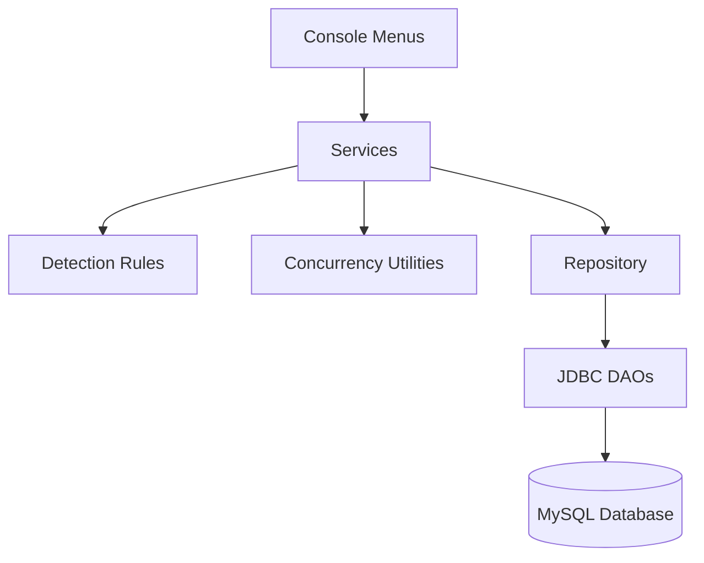
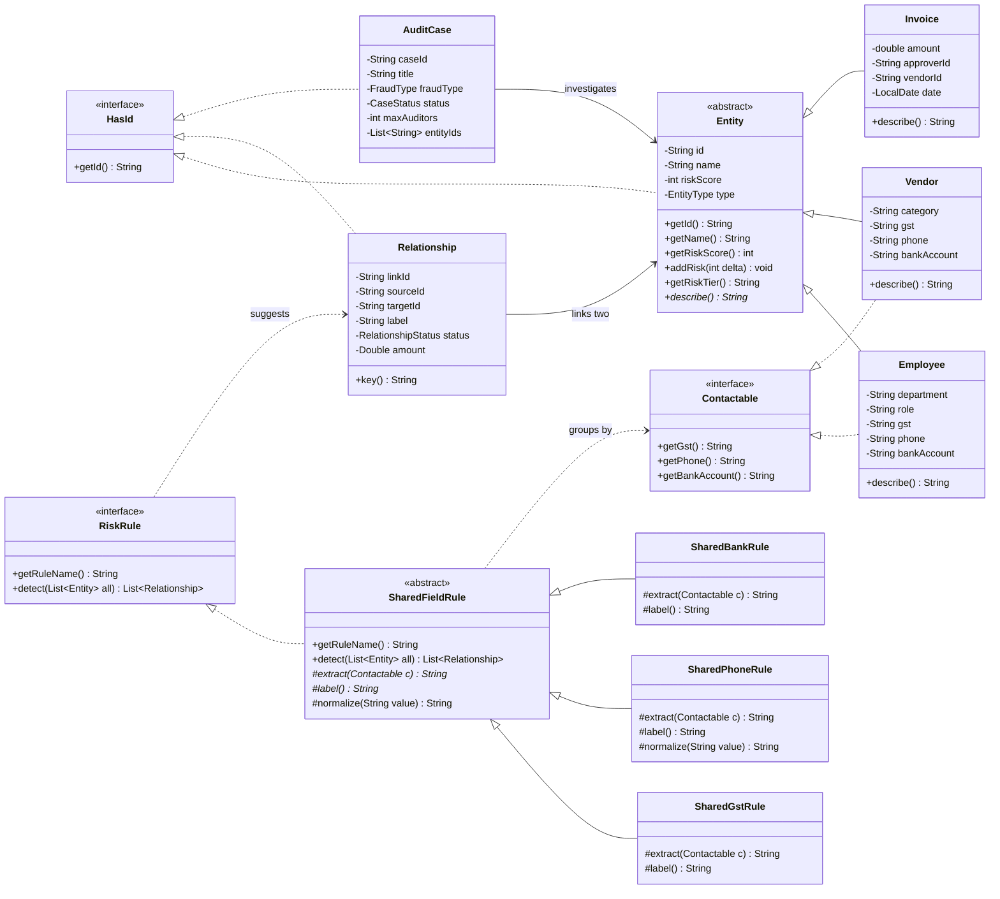
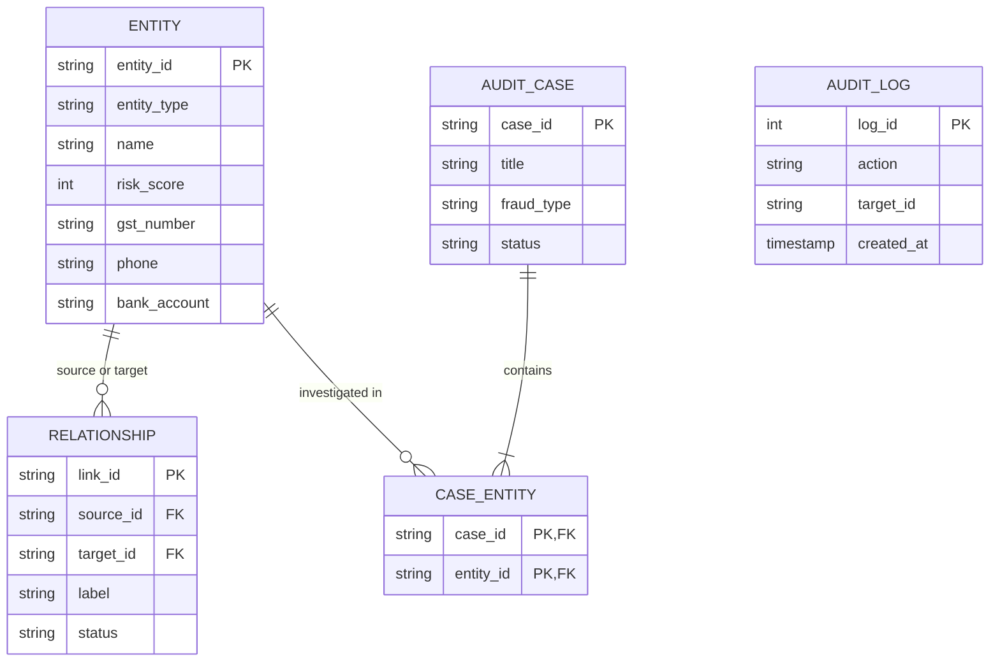

# Ravel Console
 
> **Forensic audit and relationship-mapping system for corporate fraud investigation.**
> A layered Java console application that uncovers hidden ties between employees, vendors and invoices, traces multi-hop connections, detects circular payment loops and manages investigation cases, with MySQL persistence through JDBC.
 


 
---
 
## Project Overview
 
Corporate fraud rarely happens in plain sight. It hides inside fragmented records: an employee approving invoices for a vendor registered with the employee's own phone number, or several vendors passing the same money around in a circle. In a table, each record looks routine and unrelated.
 
**Ravel Console** treats corporate data as a **network**. Employees, vendors and invoices are nodes, and the relationships between them are links. A rule engine proposes hidden links, an auditor confirms or rejects each one, and graph algorithms then expose multi-hop connections and circular payment loops. Confirmed findings are grouped into investigation cases and recorded with a full audit trail.
 
---
 
## The Problem and the Solution
 
### The problem
 
Traditional audits rely on spreadsheets and tabular views. Fraudulent networks exploit this through:
 
- **Hidden affiliations:** a shell vendor created with an approving employee's phone number, GST number or bank account.
- **Circular invoicing:** money routed A → B → C → A, which looks like three independent payments in table form.
- **Weak evidence trails:** no record of who confirmed a suspicious link, or when.
### The solution
 
Ravel Console loads corporate entities, builds a relationship graph and lets pluggable rules suggest suspicious ties. Nothing is trusted until an auditor approves it. Approved links raise risk scores, feed the path finder and loop detector, and are written to an audit log inside a database transaction.
 
---
 
## Key Features
 
| Feature | Description |
|---|---|
| **Entity registry** | Register, search, update and delete Employees, Vendors and Invoices with strict validation of IDs, GST numbers, phone numbers and amounts. |
| **Automatic invoice links** | Every invoice creates `APPROVED_BY` and `PAYABLE_TO` links to its approving employee and payee vendor. |
| **Vendor payment links** | Vendor-to-vendor `PAYMENT` transfers can be recorded to model subcontracting chains and circular billing. |
| **Rule-based link detection** | Pluggable rules flag entities that share a GST number, phone number or bank account and propose them as `SUGGESTED` links. |
| **Human-in-the-loop review** | Auditors approve or reject each suggestion. Approval raises the risk score of both entities and writes an audit log entry in one atomic transaction. |
| **Shortest-path finder** | Breadth-first search reveals the minimum-hop connection between any two entities. |
| **Circular loop detection** | Depth-first search reports closed payment cycles such as `VEN-001 → VEN-002 → VEN-003 → VEN-001`. |
| **Risk scoring and reports** | Every entity has a 0-100 risk score (LOW, MEDIUM, HIGH), with a Top-5 riskiest report and link counts by status. |
| **Case management** | Entities are grouped into investigation cases. An entity can belong to only one active case, even under concurrent requests. |
| **Concurrent processing** | Synchronized slot locking, a producer-consumer ingestion queue and parallel rule execution on a thread pool. |
| **Persistent storage** | Entities, links, cases and audit logs are stored in MySQL through JDBC DAO classes. |
 
---
 
## Console Preview
 
### Main menu
 
```text
╔══════════════════════════════════════════════╗
║   RAVEL - FORENSIC AUDIT CONSOLE             ║
╠══════════════════════════════════════════════╣
║  1. Entity Registry                          ║
║  2. Run Link Detection                       ║
║  3. Review Suggested Links                   ║
║  4. Find Connection Path                     ║
║  5. Detect Circular Loops                    ║
║  6. Record Vendor Payment                    ║
║  7. Case Management                          ║
║  8. Risk Reports                             ║
║  9. Concurrency Demo (auditor slots)         ║
║ 10. Process Incoming Queue                   ║
║ 11. Load Demo Dataset                        ║
║  0. Exit                                     ║
╚══════════════════════════════════════════════╝
```
 
### Suggested and approved links
 
```text
 SUGGESTED  [EMP-001 B. Patel] - - - - ► [VEN-004 Apex Supplies]    Shared phone
 APPROVED   [EMP-001 B. Patel] ────────► [VEN-004 Apex Supplies]    Shared phone
```
 
Dashed arrows mark links awaiting review. Solid arrows mark links confirmed by an auditor.
 
### Circular loop detection
 
```text
 ⚠ LOOP FOUND (3 entities)
  [VEN-001 Alpha Traders]
         │ PAYMENT ₹5,00,000
         ▼
  [VEN-002 Beta Logistics]
         │ PAYMENT ₹4,90,000
         ▼
  [VEN-003 Gamma Infra]
         │ PAYMENT ₹4,85,000
         ▼
  [VEN-001 Alpha Traders]  ↺ loop closes here
```
 
---
 
## System Architecture
 
Ravel Console is organised into layers. Each layer has one job and talks only to the layer directly beneath it.
 

 
**Console menus** are the only part the auditor sees. They read typed input, call a service and print the result. They contain no business rules and no SQL.
 
**Services** hold the business logic: registering and validating entities, creating and reviewing links, running detection, finding paths and loops, and opening cases. Services return data and never print.
 
**Detection rules** are small, separate classes, one for each fraud signal (shared GST, shared phone, shared bank account). The detection service runs them and turns their findings into `SUGGESTED` links. A new rule can be added without changing any existing code.
 
**Concurrency utilities** make the system safe under parallel work. A synchronized slot manager limits how many auditors can join a case, a producer-consumer queue ingests incoming invoices in the background, and a thread pool runs the three detection rules at the same time.
 
**Repository** is an interface that describes how data is saved and loaded. Services depend only on this interface, so storage can be an in-memory collection during development or MySQL in production without any change to business logic.
 
**JDBC DAOs** implement the repository for MySQL. They are the only classes that contain SQL, and every user-supplied value is passed through a `PreparedStatement`. Multi-step operations, such as approving a link, run inside a single transaction.
 
---
 
## Class Diagram
 

 
- `Entity` is abstract. `Employee`, `Vendor` and `Invoice` extend it, and each prints its own profile through `describe()`.
- Only Employee and Vendor implement `Contactable`, because invoices have no phone number or bank account.
- `RiskRule` is a strategy interface. `SharedFieldRule` holds the shared grouping logic, so each concrete rule only says which field to compare and what to call the link. The phone rule also overrides `normalize` to keep digits only.
- Status and type fields use four enums: `EntityType` (EMPLOYEE, VENDOR, INVOICE), `RelationshipStatus` (SUGGESTED, APPROVED, REJECTED), `CaseStatus` (OPEN, UNDER_REVIEW, CLOSED) and `FraudType` (SHELL_VENDOR, CIRCULAR_BILLING, CONFLICT_OF_INTEREST).
---
 
## Database Design
 
Data is stored in a MySQL database named `ravel_db`.
 

 
| Table | Purpose |
|---|---|
| `entity` | One row per Employee, Vendor or Invoice, distinguished by `entity_type`. Invoice-specific values (amount, approver, vendor) are stored in extra columns of the same table. |
| `relationship` | Graph links between two entities, with a label, a status (`SUGGESTED`, `APPROVED`, `REJECTED`) and an optional payment amount. |
| `audit_case` | Investigation cases with a fraud type, status and auditor capacity. |
| `case_entity` | Junction table linking cases to the entities under investigation. |
| `audit_log` | Timestamped record of every approved link. |
 
Key design points:
 
- `relationship` has a unique constraint on `(source_id, target_id, label)`, so duplicate links are blocked at the database level.
- GST number, phone and bank account are intentionally **not** unique, because sharing them is the fraud signal the system detects.
- Approving a link runs as one JDBC transaction: the status update, the risk increase on both entities and the audit log insert are committed together, or rolled back if any step fails.
- The rule that an entity can be in only one active case cannot be expressed in the schema, so `CaseService` enforces it under a lock.
---
 
## How the System Works
 
1. **Register entities.** Employees, vendors and invoices are validated and stored. Each invoice automatically creates links to its approver and payee.
2. **Record payments.** Vendor-to-vendor transfers are added as `PAYMENT` links.
3. **Run link detection.** Each rule groups entities by a normalised shared value (GST, phone or bank account). Any group of two or more produces `SUGGESTED` links.
4. **Review suggestions.** The auditor approves or rejects each link. Approved links raise risk scores and are logged. Rejected links are never suggested again.
5. **Analyse the network.** The path finder returns the shortest chain between two entities. The loop detector reports circular payments.
6. **Open a case.** Flagged entities are grouped into an investigation case with a status and fraud type.
7. **Process incoming data.** A producer-consumer queue registers new invoices in the background, and detection can run all three rules in parallel.
---
 
## Business Rules
 
- **Shared identifiers are allowed.** Only entity, link and case IDs are unique. GST, phone and bank account may repeat.
- **Strict validation.** IDs follow `EMP-`, `VEN-` or `INV-` plus digits. GST numbers match the 15-character GSTIN format. Phone numbers are normalised to exactly 10 digits. Invoice amounts must be positive.
- **Link lifecycle.** A link is `SUGGESTED`, `APPROVED` or `REJECTED`, and a suggestion can be decided only once.
- **Graph analysis.** The path finder uses approved links in both directions. The loop detector follows approved payment links in their direction only.
- **Risk scoring.** Scores range from 0 to 100. Approving a link adds 15 points to both entities. A score of 70 or above is HIGH risk.
- **Case locking.** An entity cannot be in two active cases at once, and each case admits a limited number of auditors. Both checks run inside synchronized critical sections.
---
 
## Folder Overview
 
| Folder | Role | Main contents |
|---|---|---|
| `model/` | The core data objects of the system. No printing and no SQL. | `Entity`, `Employee`, `Vendor`, `Invoice`, `Relationship`, `AuditCase`, `AuditLog`, enums, `HasId`, `Contactable` |
| `rules/` | The fraud-detection engine. Each class looks for one kind of hidden tie. | `RiskRule`, `SharedFieldRule`, `SharedGstRule`, `SharedPhoneRule`, `SharedBankRule` |
| `repository/` | The storage contract that hides where data lives. | `Repository`, `InMemoryRepository` |
| `service/` | Business logic: registration, link lifecycle, detection, graph algorithms and case rules. | `EntityService`, `RelationshipService`, `DetectionService`, `GraphService`, `CaseService` |
| `concurrency/` | Everything related to threads and synchronization. | `CaseSlotManager`, `ReviewTask`, `IngestQueue`, `IngestProducer`, `IngestConsumer`, demo runners |
| `dao/` | Data access objects. The only place SQL appears. | `EntityDAO`, `RelationshipDAO`, `CaseDAO`, `AuditLogDAO` |
| `database/` | Opens connections to MySQL using the settings in the config folder. | `DBConnection` |
| `exception/` | Custom exceptions for invalid data, duplicates and full cases. | `InvalidEntityException`, `DuplicateRecordException`, `CaseFullException`, `CaseAlreadyActiveException` |
| `util/` | Shared helpers for validation, input and display. | `InputValidator`, `ConsoleInput`, `GraphPrinter`, `IdGenerator` |
| `ui/` | The console menus that connect the user to the services. | `EntityMenu`, `GraphMenu`, `CaseMenu` |
| `main/` | The application entry point and menu loop. | `RavelApp` |
| `sql/` | The database schema script. | `ravel_schema.sql` |
| `config/` | Database connection settings template. | `db.properties.example` |
| `lib/` | External libraries. | MySQL Connector/J |
| `docs/` | Diagrams, test cases and demonstration evidence. | `TEST_CASES.md`, screenshots |
 
---
 
## Tech Stack
 
| Category | Technology |
|---|---|
| Language | Java 17 |
| Database | MySQL 8.0 |
| Database connectivity | JDBC with MySQL Connector/J |
| Data structures | Java Collections Framework (`HashMap`, `HashSet`, `ArrayList`, `Queue`) |
| Concurrency | Java threads, `synchronized`, `wait` / `notifyAll`, `ExecutorService` |
| Text processing | Regular expressions, `StringBuilder` |
| Development tools | VS Code or IntelliJ IDEA, Git, GitHub |
 
---
 
## Future Prospects
 
- **Stream-based analytics:** grouped link counts, average risk per entity type and exposure per vendor using the Java Streams API.
- **Bulk data handling:** validated CSV import of entities and export of investigation reports.
- **Richer detection rules:** shared PAN portion of GST numbers, fuzzy name matching, abnormal invoice amounts and timeline gaps between approval and payment.
- **Automated reporting:** one-step generation of formatted forensic reports containing the confirmed evidence chain.
- **Persistent case assignments:** store auditor slot allocations in the database instead of memory.
- **Role-based access:** auditor, senior auditor and administrator permissions with a per-user audit trail.
- **Real-time ingestion:** event-stream integration with enterprise systems so suspicious transactions are flagged as they occur.
- **Scalable graph storage:** benchmarking relational recursive queries against a dedicated graph database for large networks.
- **Automated testing:** unit tests for validation, detection rules and graph algorithms.
 